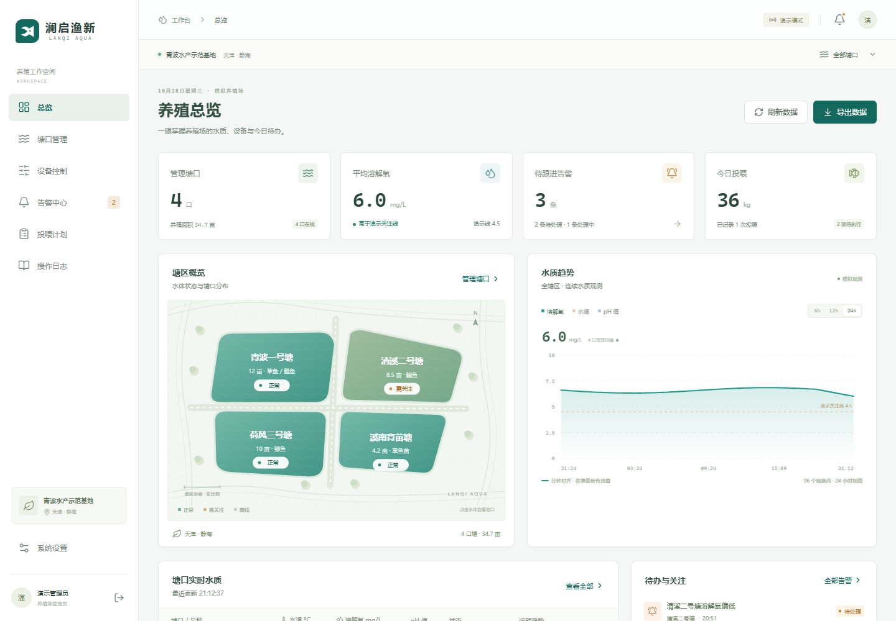

# 澜启渔新 Lanqi Aqua

面向水产养殖的 Web 管理端、原生鸿蒙 App 与共享设备接口。

## 包含什么

| 部分 | 实现 |
| --- | --- |
| Web 管理端 | React 19 / TypeScript / Vite，水质总览、多塘口、设备控制、告警流程、投喂计划、日志、CSV 与设置 |
| 原生鸿蒙 App | ArkTS / ArkUI Stage，兼容 API 12，监测、设备回执、告警与投喂，配置自己的服务地址 |
| 后端 | Node.js 24 / Express 5 / SQLite，服务端共享持久化状态、登录会话、动作与回执、网关接入 |
| 开源资料 | 构建说明、接口契约、贡献指南、问题模板、验证记录与许可说明 |

项目目录：

```text
apps/web/       Web应用
apps/harmony/   原生鸿蒙工程
services/api/   共享API与HTTP集成测试
docs/           运行 设备接入 与开发约定
```

## 界面预览

桌面端总览，图中均为模拟数据：



登录与手机适配见 [界面预览](docs/SCREENSHOTS.md)。原生鸿蒙页面以实际签名安装后的显示为准。

## 本地运行

需要 **Node.js 24** 与 npm。运行 `node --version` 确认版本；后端使用 Node 自带 `node:sqlite`，无需另装数据库服务。

```bash
npm ci
npm run dev
```

打开 **http://127.0.0.1:5173**，选择进入演示养殖场。API 在 http://127.0.0.1:4300。首次启动建立四个示例塘口、模拟设备、历史曲线、告警与投喂计划。Web 与鸿蒙客户端连接到同一个 API 后，共享设置、任务、告警和操作结果；浏览器刷新或后端重启后变更仍保留。

默认只监听本机。`.env.example` 是可复制的配置样例；本地 `.env` 与数据库不提交仓库。

### 编译后运行

```bash
npm run check
npm test
npm run build
npm start
```

生产构建后，后端在 **http://127.0.0.1:4300** 同时提供 Web 静态页面和 API。无须同时运行 Vite。

## 可实际操作的功能

- 按塘口查看水温、溶氧、pH、水位和浊度，切换趋势范围、塘口筛选和总览示意图。
- 创建塘口。新增塘口默认离线，读数显示空缺，避免把零初始化值显示为现场测量。
- 向在线增氧机、投喂机、水泵提交启停请求。界面等待服务端回执；演示模式约1.4秒产生模拟回执。离线和已有待回执设备不接受重复动作。
- 按“待确认 → 已确认 → 已解决”处理告警。记录操作者和时间，终态不可倒退。
- 新建未来时间的投喂计划、人工确认记录完成或取消。人工完成不是设备计量回执。
- 保存基地设置、查询共享操作日志、下载带来源信息的观测 CSV。
- 演示低氧/恢复场景。仅演示模式提供此接口，不会向真实设备发送模拟数据。

## 鸿蒙 App

原生项目位于 [apps/harmony](apps/harmony/README.md)，不是 WebView 包装页。已使用本地 DevEco SDK 完成 ArkTS / 资源 / release HAP 编译。鸿蒙 **未签名 HAP 需要使用自己的开发者签名** 后安装；仓库不包含证书、私钥或个人 profile。

```powershell
./apps/harmony/build-unsigned.ps1 -DevEcoHome 'D:/Program Files/Huawei/DevEco Studio'
```


## 真实设备接入

将 `DEMO_MODE=false` 并设置管理员账号、至少12字符的密码和至少16字符的设备网关 token。首次启动真实模式数据库为空，与演示数据完全分开。真实模式关闭演示登录及模拟场景，使用自己的管理员凭据。

先通过 `/api/ponds`、`/api/devices` 注册塘口与设备，随后网关使用独立 Bearer token 上报观测、发送心跳、领取待执行指令并回传执行结果。
请阅读 [API契约](docs/API.md) 与 [网关接入说明](docs/GATEWAY.md)。生产部署应在反向代理后启用 HTTPS、`SECURE_COOKIES=true`，必要时配置 `WEB_ORIGINS`；默认不信任任意跨站访问。此原型不替代养殖专业判断、电气联锁或设备厂商的安全保护。

## 验证

```bash
npm run check   # 两个TypeScript项目检查
npm test        # 真实HTTP请求验证身份、命令、回执、状态机和持久性
npm run build   # Web和API编译
```

浏览器与鸿蒙构建验证结果记录在 [docs/VERIFICATION.md](docs/VERIFICATION.md)。数据库保存在仓库 `data/` 并被 Git 忽略；重置演示时先停止服务，再备份并移走 `data/demo.sqlite` 及其 WAL/SHM 旁文件。

## 许可与边界

本仓库本次新编写的代码和原创 SVG 使用 **Apache-2.0**；第三方包遵循各自许可证，见 [THIRD_PARTY_NOTICES.md](THIRD_PARTY_NOTICES.md)。本仓库不包含商业 JACE/Niagara 实现、不提供华为云服务授权、不转授既有专利/软著共有成果，也不包含项目旧代码、真实设备密钥或原文档中的个人签名材料。

贡献流程见 [CONTRIBUTING.md](CONTRIBUTING.md)，安全问题见 [SECURITY.md](SECURITY.md)。
